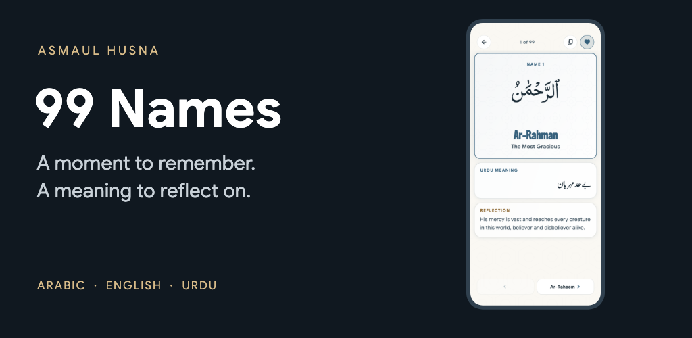
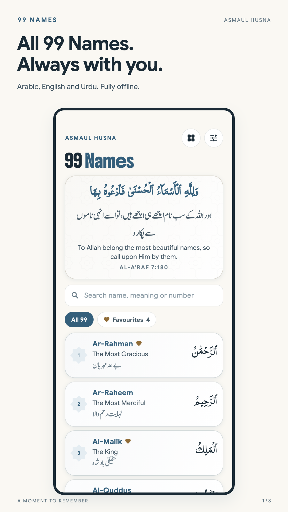
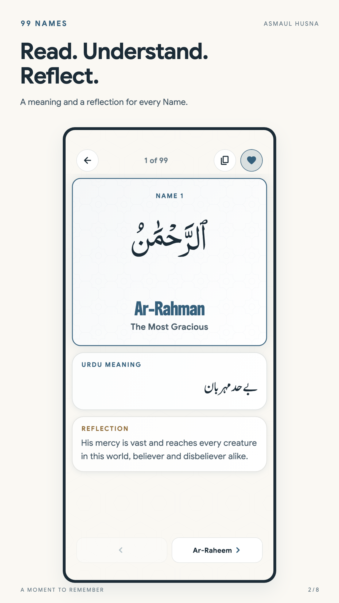
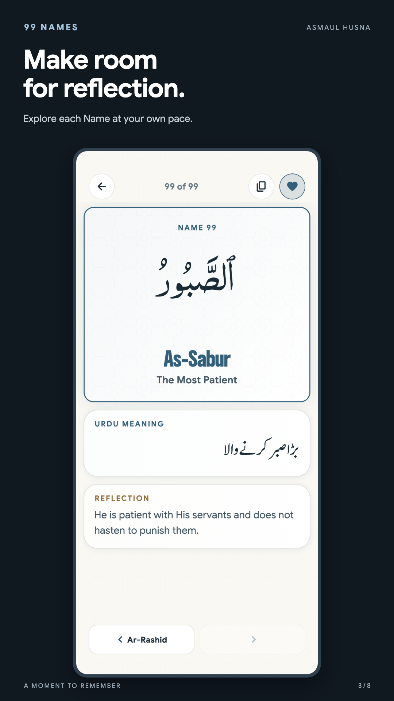
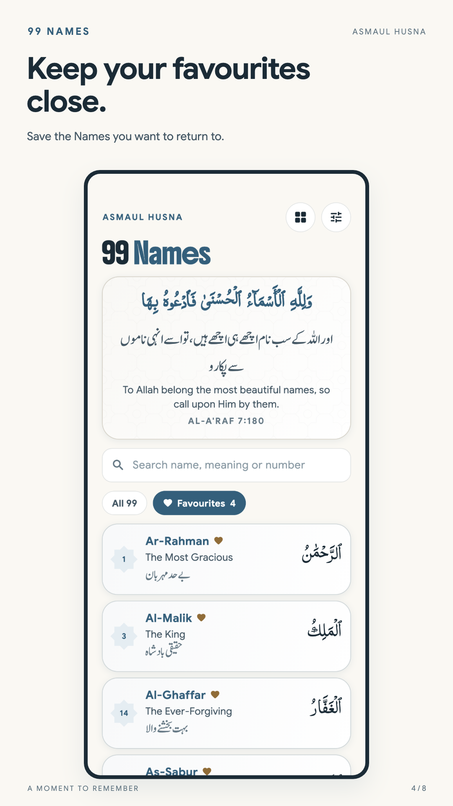
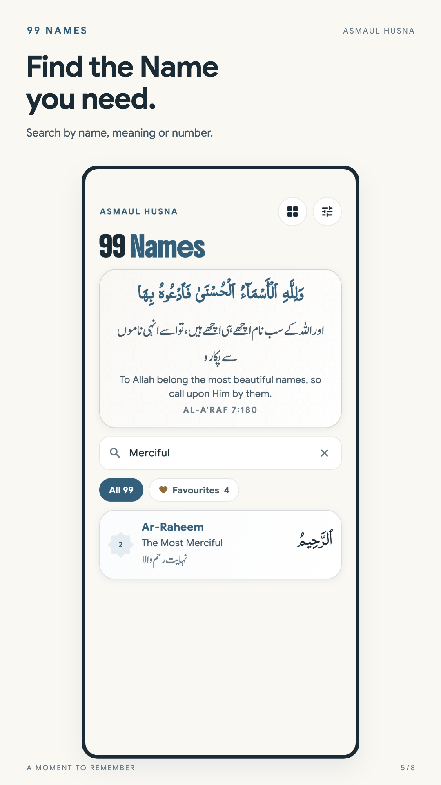
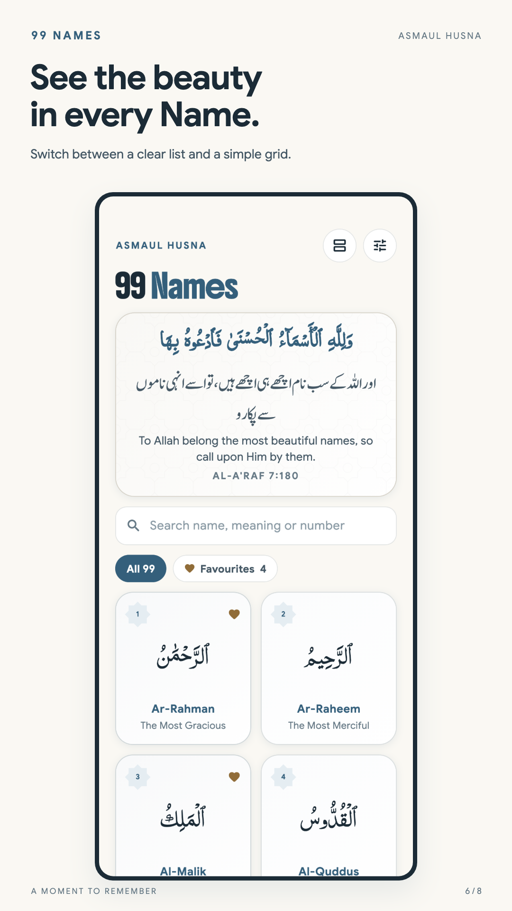
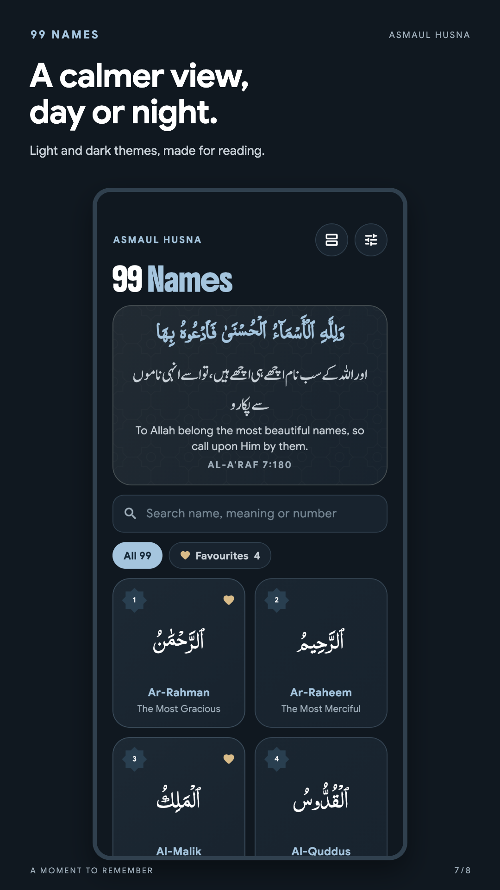
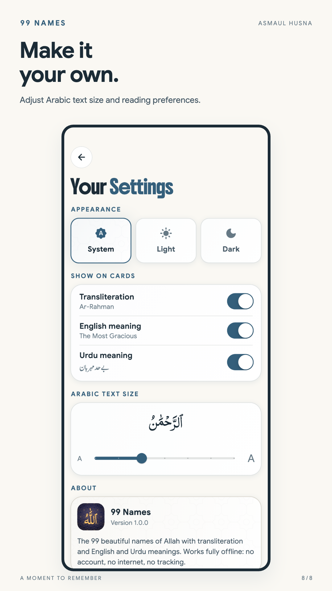

  
  <h1>99 Names - Asmaul Husna</h1>
  
The 99 beautiful names of Allah. Arabic, English and Urdu. Fully offline.

  

The 99 beautiful names of Allah — Arabic, transliteration, English and Urdu
meanings, with a short reflection for each. Fully offline: no account, no
network permission, no analytics.

- Package / bundle ID: `com.muzamil.asmaulhusna`
- Themes: System, Light, Dark (ink blue, ivory + bronze)
- Content: `lib/src/data/names.dart`

## Screenshots

  
  
  
  
  
  
  
  

For reproducible app captures and Play Store artwork, see [the screenshot guide](tool/screenshots/README.md).

## Fonts & credits

| Font | Used for | Source | Licence |
|---|---|---|---|
| Jameel Noori Nastaleeq | Urdu | [urdufonts.net](https://urdufonts.net/fonts/jameel-noori-nastaleeq-regular) | Free of charge for Urdu lovers |
| PDMS Saleem Quran | Arabic | [urdunigaar.com](https://urdunigaar.com/download/pdms-saleem-quran-font-ttf-file-download/) | © 2001 Pakistan Data Management Services |
| Google Sans | Text | [Google Fonts](https://fonts.google.com/specimen/Google+Sans) | SIL OFL 1.1 |
| Boldonse | Titles | [Google Fonts](https://fonts.google.com/specimen/Boldonse) | SIL OFL 1.1 |

The same credits appear in the app under Settings → Fonts & credits.

`assets/fonts/` holds copies trimmed to exactly what the app draws (about
350 KB in total; Jameel Noori Nastaleeq alone goes from 10.5 MB to 75 KB).
After changing any text in `lib/`, download the full fonts into
`tool/fonts_src/` (see its README) and regenerate:

    pip install fonttools uharfbuzz
    python3 tool/subset_fonts.py

The script lays out every Urdu string with HarfBuzz, keeps only the glyphs
used, and checks the trimmed font lays them out identically.

## App icon

The icon is the `AppLogo` widget (`lib/src/ui/app_logo.dart`): "ٱللَّٰهُ" in
PDMS Saleem Quran, gold on deep indigo, so it matches the app exactly. The same
widget appears in Settings → About. To regenerate every icon after changing it:

    tool/icon/make_icons.sh

This renders the logo to `branding/` and writes the iOS icons plus Android's
legacy, adaptive (background + foreground) and Android 13 themed icons.
Needs ImageMagick.

## Website

`website/` is the landing page, live at
https://99asmaulhusna.pages.dev (Cloudflare Pages). `node build.mjs` fills `src/index.html` with all 99 Names read from
`lib/src/data/names.dart`, so the site's Names section never drifts from the
app, and copies `public/` (fonts from `assets/fonts/`, screenshots) and the
privacy policy from `docs/privacy-policy/` into `dist/`. The privacy policy URL
for Google Play (and any later store) is https://99asmaulhusna.pages.dev/privacy;
edit `docs/privacy-policy/index.html` and redeploy to change it. Deploy with
`cd website && npm run deploy`. Arabic and Urdu use the app's trimmed fonts, so
any new Arabic or Urdu text on the site must already exist in the app; Boldonse
and Google Sans are full copies.

## Release

    flutter build apk --release --split-per-abi
    flutter build appbundle --release
    flutter build ipa --release

Android release builds are still signed with the debug key — add a signing
config in `android/app/build.gradle.kts` before publishing.

## License & Branding

The source code is licensed under [MIT](LICENSE): use, modify, and share all or part of it, including commercially, while keeping the required copyright and license notices.

The **99 Names name, logos, app icons, and branded artwork are not licensed for reuse as your own app branding**. Published forks should use their own identity unless permission is granted. See the [branding policy](BRANDING.md); third-party content retains its own terms.

99 Names is fully free. To improve the official app under the 99 Names name, contributions here are always welcome.

## Contributing

Contributions are welcome! Open an issue or send a pull request.

## Contributors

